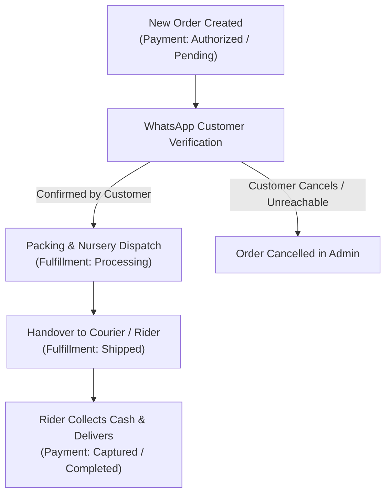

# 10 — Green Dreams Admin Operator Quick Guide

Welcome to **Green Dreams**! This guide is designed for nursery managers and administrative staff to operate the daily eCommerce workflow, manage plant care guides, and fulfill customer Cash on Delivery (COD) orders.

---

## 1. Accessing the Admin Dashboard

- **Production Admin URL:** `https://medusa-backend-production-e218.up.railway.app/app`
- **Default Administrator Account:**
  - **Email:** `admin@greendreams.com`
  - **Password:** *(Provided securely during handover)*

> [!IMPORTANT]
> Always change your password upon initial login and store administrative credentials in a secure password manager.

---

## 2. Managing Products & Plant Care Guides

Green Dreams is built specifically for botanical care. Each plant product includes specialized care instructions that directly help customers keep their plants healthy.

### Adding or Editing a Plant:
1. In the Medusa Admin sidebar, navigate to **Products**.
2. Click **New Product** (or select an existing plant, e.g., *ZZ Plant*, *Peace Lily*).
3. Fill in the standard commerce details:
   - **Title:** e.g., `Monstera Deliciosa` (do not include sample tags).
   - **Subtitle:** Short Bengali summary (e.g., `আইকনিক সুইস চিজ প্ল্যান্ট - যেকোনো রুমের আকর্ষণ`).
   - **Sales Region & Currency:** Ensure the Bangladesh sales region is active with prices in **BDT (৳)**.
   - **Thumbnail & Gallery:** Upload clear, high-resolution photos of the plant in its pot.
4. **Plant Care Metadata Profile:**
   In the product metadata section or Plant Care widget, review the 7 core attributes:
   - `difficulty`: `easy` (সহজ যত্ন), `medium` (মাঝারি যত্ন), or `advanced` (স্পেশাল কেয়ার).
   - `petSafety`: `safe` (গৃহপালিত প্রাণীদের জন্য নিরাপদ) or `toxic` (বিষাক্ত/সাবধানে রাখুন).
   - `light`: Recommended sunlight exposure (e.g., *উজ্জ্বল পরোক্ষ আলো*).
   - `water`: Watering schedule (e.g., *মাটির উপরের ২ ইঞ্চি শুকালে পানি দিন*).
   - `humidity`: Humidity needs (e.g., *৫০%-৬০% সাধারণ ঘরের আর্দ্রতা*).
   - `fertilizer`: Feeding schedule (e.g., *গ্রীষ্মকালে মাসে একবার জৈব সার*).
   - `repotting`: Pot upgrade advice (e.g., *প্রতি ১–২ বছর পর বসন্তে টব পরিবর্তন করুন*).

> [!TIP]
> Never invent botanical facts. Ensure all plant care information is verified with nursery experts prior to publishing.

---

## 3. Cash on Delivery (COD) Order Fulfillment Workflow

In Bangladesh, all initial customer orders are placed via **Cash on Delivery (COD)**.

### Step-by-Step Operator Instructions:

1. **Order Review:**
   - Go to **Orders** in the Admin panel.
   - Open the new order. Review customer name, delivery address, selected district (Dhaka / Outside Dhaka), and delivery fee (৳60 for Dhaka, ৳130 for outside Dhaka).

2. **WhatsApp Customer Confirmation:**
   - Click the customer's phone number or use the **WhatsApp Quick-Chat** widget.
   - Send the order confirmation template:
     > *"আসসালামু আলাইকুম [Customer Name], গ্রিন ড্রিমস থেকে আপনার অর্ডার #[Order ID] পেয়েছি। আপনার মোট মূল্য ৳[Total] (ডেলিভারি চার্জ সহ)। আপনার ঠিকানা: [Address]। আমরা কি আপনার চারাগাছগুলো ডিসপ্যাচ করব?"*

3. **Nursery Packing & Dispatch:**
   - Once confirmed, carefully inspect the plant foliage, soil moisture, and protective wrapping.
   - In Admin, create the **Fulfillment** and mark the items as prepared.

4. **Cash Collection & Completion:**
   - When the delivery rider/courier delivers the package and collects cash in hand, mark the payment as **Captured** and order as **Completed**.
   - If the delivery is returned or rejected, mark fulfillment as cancelled and return stock to nursery inventory.
